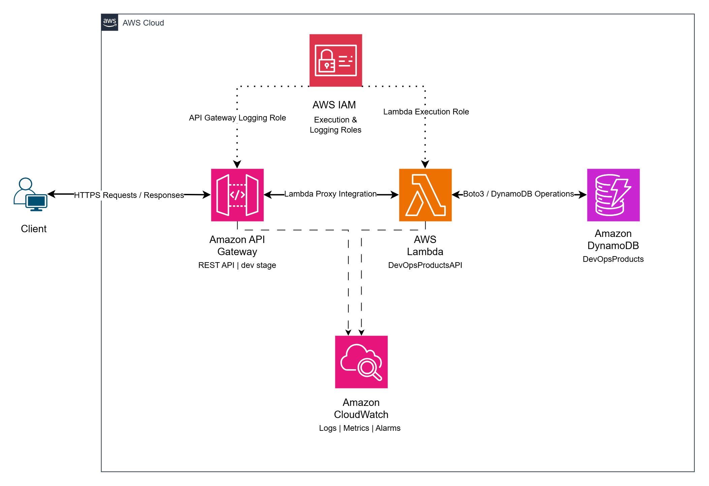

# AWS Serverless Product Management REST API

A serverless REST API built using Amazon API Gateway, AWS Lambda,
Amazon DynamoDB, Python, Boto3, IAM, and Amazon CloudWatch.

## Project Overview

This project demonstrates how to build, deploy, monitor,
and troubleshoot a serverless CRUD API on AWS.

The API allows clients to create, retrieve, update,
and delete product records stored in DynamoDB.

## Architecture



Client
|
v
Amazon API Gateway (REST API)
|
v
AWS Lambda (Python)
|
v
Amazon DynamoDB

Monitoring: Amazon CloudWatch
Security: AWS IAM and Lambda execution roles

## AWS Services Used

- Amazon API Gateway: REST API endpoints and routing
- AWS Lambda: Serverless backend processing
- Amazon DynamoDB: NoSQL product storage
- AWS IAM: Least-privilege resource access
- Amazon CloudWatch: Logging, metrics, and alarms

## API Endpoints

| Method | Endpoint       | Description           |
| ------ | -------------- | --------------------- |
| GET    | /products      | Retrieve all products |
| POST   | /products      | Create a product      |
| GET    | /products/{id} | Retrieve one product  |
| PUT    | /products/{id} | Update a product      |
| DELETE | /products/{id} | Delete a product      |

## Example Request

POST /products

```json
{
  "ProductID": "P001",
  "ProductName": "Mechanical Keyboard",
  "Price": 1500,
  "Quantity": 12
}
```

## Example Response

HTTP 201 Created

```json
{
  "message": "Product created",
  "product": {
    "ProductID": "P001",
    "ProductName": "Mechanical Keyboard",
    "Price": "1500",
    "Quantity": 12
  }
}
```

## Security

- A dedicated Lambda execution role was configured.
- DynamoDB permissions were scoped to a specific table.
- No AWS credentials are stored in the source code.
- IAM administrative access was protected with MFA.

Note: API Gateway method authorization was intentionally
not enabled for this temporary learning environment.

The deployed API must not be exposed publicly with
sensitive data or used in production without appropriate
authentication, authorization, and security controls.

## Monitoring and Troubleshooting

- Enabled API Gateway execution logging.
- Reviewed API Gateway CloudWatch metrics.
- Created a CloudWatch alarm for 5XX errors.
- Simulated an alarm state transition.
- Tested application-level HTTP error responses.
- Investigated API request logs in CloudWatch.

## Testing

The following operations were tested successfully:

- Create product (POST)
- Retrieve all products (GET)
- Retrieve individual product (GET)
- Update product (PUT)
- Delete product (DELETE)
- Retrieve a nonexistent product (HTTP 404)
- External API requests using Windows PowerShell

## Deployment

The application was deployed in AWS us-east-1
using the AWS Management Console.

API Gateway stage: dev

The repository contains the application source code.
Infrastructure was configured manually during the lab.

A reproducible Infrastructure as Code deployment
is not yet included.

## Limitations

This project is intended for educational use.

Production improvements would include:

- API authentication and authorization
- Automated infrastructure provisioning
- CI/CD deployment pipelines
- Input validation and structured error handling
- Automated tests
- Improved error responses and HTTP semantics
- Pagination for large DynamoDB datasets
- Monitoring notifications and operational runbooks

## Learning Outcomes

- Implemented REST API CRUD operations.
- Connected API Gateway with AWS Lambda.
- Used Python Boto3 to access DynamoDB.
- Configured least-privilege IAM permissions.
- Tested API endpoints through PowerShell.
- Enabled CloudWatch logging and monitoring.
- Investigated HTTP errors and alarm transitions.
